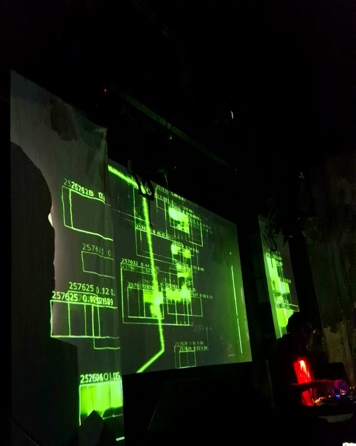
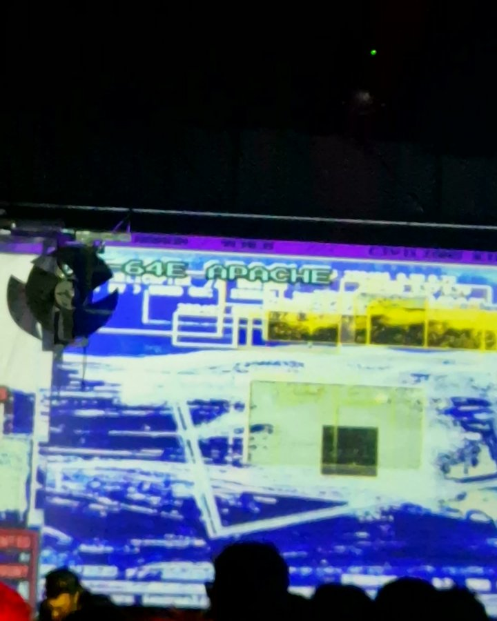
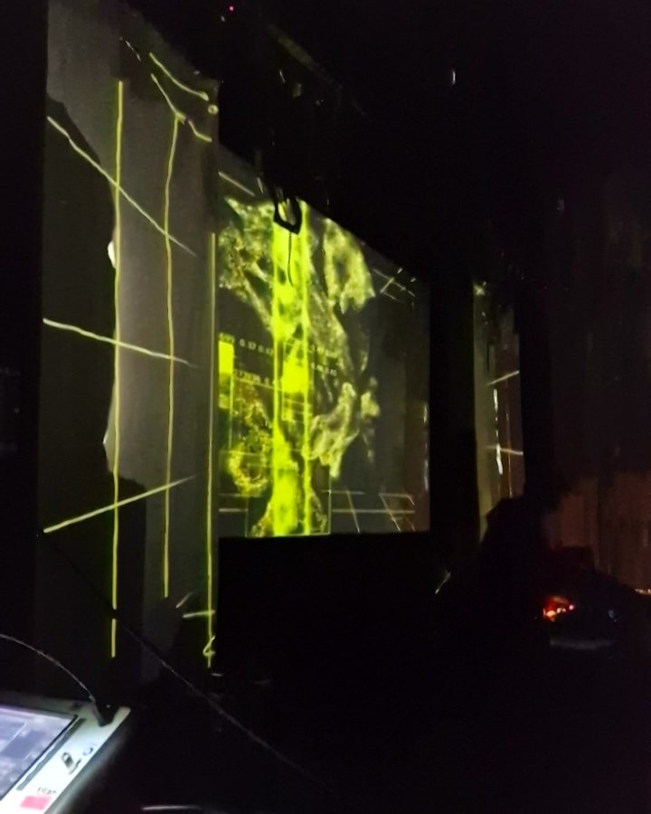
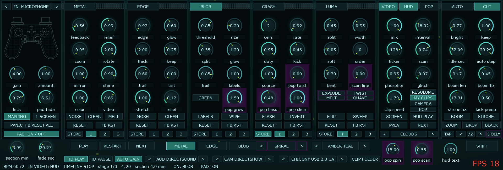
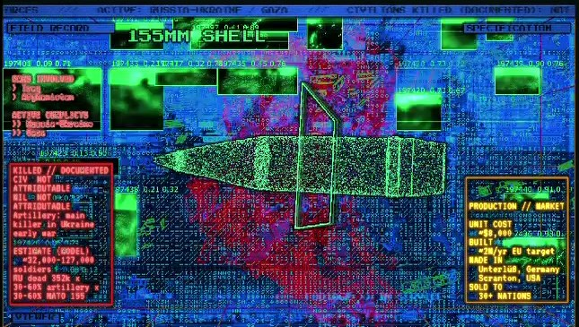
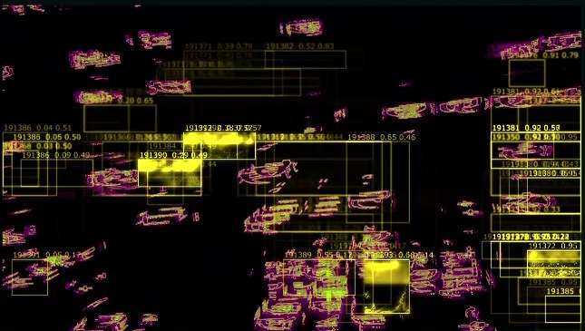
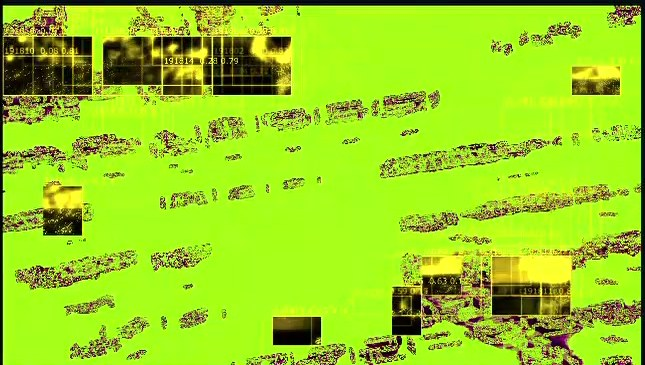
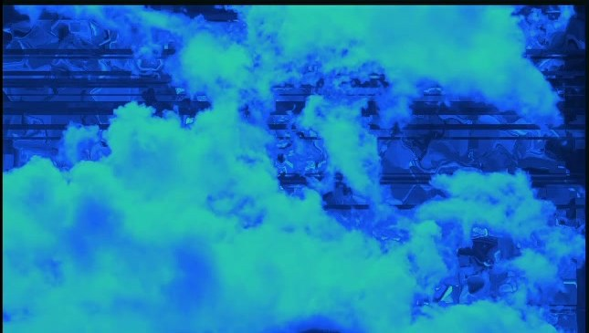

# WEAPONS OF CHOICE

A free live-visual set for TouchDesigner: a retro game HUD of 15 modern weapons, an audio-reactive effect chain, one control panel, a gamepad, and mapping on 1 to 3 screens.

This is the set I played live at **Interferenze, Bunker Torino**. It's now free, so anyone can take it apart and play with it.

| | | |
|---|---|---|
|  |  |  |

## Why a weapons archive

Not because we like weapons. The countries we live in use war to make money: public budgets turn into profit for the
arms lobbies, not for the people who pay for them. Those wars are wrecking the world and terrorising whole populations.
The HUD puts the machines on screen with what we could find about them: who makes them, who buys them, where they are
used, what they cost.

## What's inside

1. **WEAPONS OF CHOICE: the HUD.** 15 weapons made in Europe or the USA, from the F-35 to the 155mm shell. Each one has its maker, factories, buyers, wars and cost, shown as a retro game screen with the weapon as a point cloud. The data and its sources are in `WeaponsArchive/` (`weapons.json`, `ESTIMATES.md`). Estimates are always labelled as estimates.
2. **The engine.** Liquid chrome feedback (METAL), EDGE, MOSH and DEPTH mosh, BLOB tracking boxes, CRASH cell mosaic, LUMA brightness layers, BOOM, DROP, STROBE, ZOOM and BLACK, plus 8 colour schemes. Everything follows the audio: there's an AUTO GAIN on/off switch, and the meters show raw and boosted levels side by side.
3. **Your sources.** Your own clips folder, Resolume over Spout, a camera, or the point clouds. Any of them can be mixed with the HUD.
4. **A gift from Giga.** Two bone sculptures from the drawings and murals of [Giga (@giga_rlt)](https://www.instagram.com/giga_rlt/), turned into 3D with [meshy.ai](https://www.meshy.ai) and then into point clouds. They float in a quad-reprojected room with a dolly zoom, and they swell with the bass.
5. **Output.** 1 screen by default. Mapping is done with kantanMapper, and 2 or 3 screens are one button away.

| | | | |
|---|---|---|---|
|  |  |  |  |

It's built mostly with nodes. Python only runs on events (clicks, pad presses, menu changes), not every frame. The exceptions are the blob tracker and the panel logic.

## Quick start

1. Install [TouchDesigner](https://derivative.ca/download). It was built and played on build **2025.32460** on Windows.
2. Download this repo and keep the folder together: the `.toe` loads its models, fonts, HDRI and mapping files from the folders next to it.
3. Open `WeaponsOfChoice.toe`. The control window opens with the panel on top and the output and meters under it.
4. **Audio**: in the setup row at the bottom of the panel, use `< AUD driver >` and then the device stepper (top left) to pick your input. Turn AUTO GAIN on to boost quiet inputs, or off to see what the input really sends.
5. **Video**: in the INPUT column, pick RESOLUME (Spout sender "Arena - Composition"), MY CLIPS (drop videos in `clips/`, or pick a folder with CLIP FOLDER), CAMERA (pick the driver and the device in the setup row), or POP (Giga's point clouds).
6. If the picture looks frozen, press **TD PLAY**. TouchDesigner's own clock may be paused.

The weapon footage that played in the HUD boxes at the show is **not** included. The HUD works without it; the footage boxes just stay empty. To put your own footage in, add the clips to `WeaponsArchive/videos/final_hap/` with the names in `weapons.json` (`video_a`, `video_b`).

Performance: at 1920x1080 on a GTX 1070 it ran at about 25 fps with the HUD, blob and metal on together. Effects that are off don't cook.

## Playing it

### Panel
- **Top row**: each effect's on/off (METAL, EDGE, BLOB, CRASH, LUMA), then VIDEO / HUD / POP, then AUTO and CUT (cut or fade).
- **Each column** sits on its own dark card: 8 look knobs, 2 actions, RESET (knobs back to the defaults), FB RST (clear the feedback) and 4 presets. Press STORE and then a number to save, or a number on its own to recall. Controls on a **violet** backing belong to the POP point clouds, whichever column they sit in.
- **METAL** has a **NOISE** button: on, the liquid chrome is shaped by noise plus your picture (knob **video** sets the mix); off, only your picture shapes it.
- **Left column**: the gamepad drawing, which lights each button as you press it. Below it are the audio knobs (gain, amount, kick, pad fade), then MAPPING, screens, PANIC (clear every feedback) and **PAD ON / OFF**.
- **Master column**: BOOM, STROBE, ZOOM, DROP and BLACK. BLACK is always the very last stage before the output.
- **Timeline row**: PLAY / RESTART / NEXT run the show through METAL > EDGE > BLOB. The colour scheme, the POP model and TAP tempo are here too.
- **SHIFT** (bottom right): while it's on, panel changes wait. Press SHIFT again and they all land on the same frame.
- **AUTO**: when nobody touches anything for `idle sec`, it plays the show on its own and changes the look every `auto step` seconds.

### Gamepad (Xbox-style)
Plug the pad in and it turns on (status line: `PAD: ON`); **PAD ON / OFF** on the panel turns it off. One map, made for anyone walking by:

Nothing changes for good. Taps are bangs, holds go back when you let go, and AUTO keeps running underneath. A = BOOM, hold B = CRASH, X = HIT, Y = next look, LB = strobe, RB = DROP, LT = HUD, hold RT = EDGE, D-pad = colours and clips, sticks = DIFFERENCE with the POP clouds and the clips.

### Screens
`/show` page **Screens**: 1, 2 or 3 screens. Each effect can run on its own screens (the S1 S2 S3 buttons next to its name). For the mapping, press MAPPING to open kantanMapper and drag the corners. The default layouts are in `mapping/`.

## The network
Open the root network: four comment boxes explain it.
1. **Effect chain**, top to bottom: `input` > `fx_metal` > `fx_mosh` > `fx_blob` > `fx_strobe` > `fx_boom` > `fx_luma` > `grade`.
2. **Shared parts**: `audio` (op.Audio, bands low/mid/high/kick that every effect reads), `show` (op.Show: timeline, AUTO, beat, pad maps, screens), `weapons_hud` (op.Hud), `src_pop` (the point clouds).
3. **Output stack**: the layers that go back on top after the grade (blob, HUD text, scan line), then DROP, then BLACK, then `null_fx` > mapping > `out1`.
4. **Control panel**: one GLSL TOP draws every knob and button. The layout is a Python list in `control/knobs`.

The shaders and scripts are embedded in the `.toe`. `code/` and `shaders/` hold copies for reading.

## Credits
- **Giga ([@giga_rlt](https://www.instagram.com/giga_rlt/))**: the drawings and murals behind the two bone models. He did the deco at Projekt X Tekno Karnival 26, Bunker Torino. Without him this set would be an empty grid.
- **B2BK ([@b2bk.fr](https://www.instagram.com/b2bk.fr/))**: I learned the dolly / quad-reprojection room from his Patreon projects (Dolly Zoom, Quad Reprojection). Thanks for the great projects. No B2BK file is included; the room was rebuilt from scratch.
- **[Tuneli Touring Club](https://www.instagram.com/tuneli_touring_club/)**: always a source of stylistic inspiration.
- **Okamirufu Vizualizer**: the liquid chrome look follows his tutorial ["Metallic Glass Y2K Aesthetic"](https://www.youtube.com/watch?v=YLnmP48qFhY).
- **kantanMapper** (TouchDesigner palette) for the mapping.
- **[@andreabanone_bam_bam](https://www.instagram.com/andreabanone_bam_bam/)**: played it live with me at Interferenze, Bunker Torino.
- **[Pixels Smoothies](https://www.instagram.com/pixels_smoothies/)**: my collective. 100% pixels, 0% fruit.
- Made in **[TouchDesigner](https://derivative.ca)**.

## Licences
- My code, shaders and the `.toe` network: MIT (see `LICENSE`).
- Giga's point clouds (`models/`): a gift from Giga for this project, shared with his blessing. You may use them in this set and in your own TouchDesigner work, with credit to @giga_rlt. They are **not** under MIT, so don't sell them or redistribute them on their own.
- The weapon models in `WeaponsArchive/models/`: each one keeps its own licence (CC0, CC-BY 3.0/4.0, OGA-BY 3.0, GPL 2.0+). The authors and links are in `WeaponsArchive/models/index.csv`. Rows with no source were built by hand in Blender for this project.
- Fonts: Press Start 2P and VT323, SIL Open Font License 1.1 ([Google Fonts](https://fonts.google.com)).
- HDRI: `studio_small_09` from [Poly Haven](https://polyhaven.com), CC0.
- The weapons data is public information gathered on 2026-11-20. Costs and numbers are order-of-magnitude estimates; read `WeaponsArchive/README.md` before you quote them.

## Support
This set is free and stays free. If it ends up in your show, or it just saved you a weekend, you can buy me a coffee:
**[ko-fi.com/zenfortv](https://ko-fi.com/zenfortv)**. It goes back into gear, footage and the next free project.

Made by [Zen4tv](https://www.instagram.com/zen_for_tv/).
